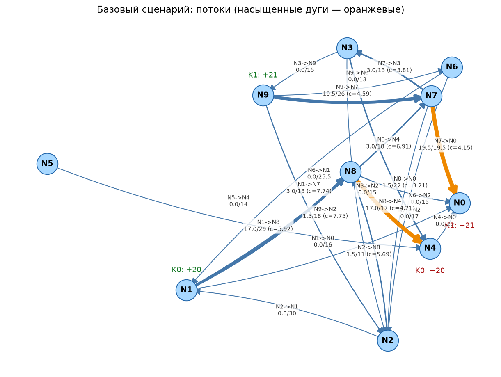

# ЛР-2. Транспортные и сетевые модели - вариант 9

**Мультитоварный поток минимальной стоимости: два груза с общей пропускной способностью.**

Параметры индивидуализации: N=4, Q=2, Y=26, отсюда
$V = 1 + ((17N + 7Q + Y) \bmod 20) = 9$,
seed $= 10000 + 100Q + N = 10204$.

## Постановка

Есть логистическая сеть: 10 вершин, 20 ориентированных дуг. Каждая дуга имеет
пропускную способность и стоимость перевозки единицы груза. По сети надо перевезти
два товара от своих источников к стокам. Ключевой момент варианта: пропускная
способность каждой дуги общая для обоих товаров, они конкурируют за нее.
Задача - минимизировать суммарную стоимость перевозок.

## Формальная модель

Множества:

- $V$ - вершины сети, $|V| = 10$;
- $A$ - ориентированные дуги, $|A| = 20$;
- $K = \{K0, K1\}$ - товары.

Параметры:

- $u_a \ge 0$ - пропускная способность дуги $a$ (единиц груза за горизонт планирования);
- $c_a \ge 0$ - стоимость перевозки единицы любого товара по дуге $a$ (у.е./ед.);
- $s_k, t_k$ - источник и сток товара $k$;
- $d_k \ge 0$ - спрос на товар $k$ (единиц груза).

Переменные: $x_{k,a} \ge 0$ - поток товара $k$ по дуге $a$ (единиц груза), непрерывные.

Целевая функция - минимум суммарной стоимости (у.е.):

$$\min \sum_{k \in K} \sum_{a \in A} c_a \, x_{k,a}$$

Ограничения. Баланс в каждой вершине для каждого товара (закон Кирхгофа):

$$\sum_{a=(v,\cdot)} x_{k,a} - \sum_{a=(\cdot,v)} x_{k,a} =
\begin{cases}
+d_k, & v = s_k\\
-d_k, & v = t_k\\
0, & \text{иначе}
\end{cases}
\qquad \forall k \in K,\ \forall v \in V$$

Общая пропускная способность дуг - это и есть мультитоварное ограничение:

$$\sum_{k \in K} x_{k,a} \le u_a \qquad \forall a \in A$$

Неотрицательность: $x_{k,a} \ge 0$.

Допущения и упрощения: стоимость линейна по объему (нет экономии на масштабе);
емкость дуги делится между товарами произвольно (груз делимый, LP-версия);
транзитное время не ограничено, потерь груза в пути нет, спрос детерминирован.

## Данные варианта

Синтетические. Генерируются `data/generate_data.py` с seed=10204, результат -
`data/network.json`. Генератор строит связный орграф (остовное дерево плюс
случайные дуги), емкости берутся из диапазона [10, 30], стоимости растут вместе
с геометрическим расстоянием. Варианты, дающие вырожденную задачу (нет конкуренции
за дуги, сценарии нерешаемы), отбрасываются; перебор детерминирован и при том же
seed воспроизводится один в один.

Итоговая сеть: товар K0 идет N1 -> N4, спрос 20; товар K1 идет N9 -> N0, спрос 21.



## Реализация

- Решатель: HiGHS через `scipy.optimize.linprog(method="highs")` (симплекс,
  presolve у HiGHS включен сам). MILP - `scipy.optimize.milp`.
- Модель (матрицы ограничений) собирается в `src/model.py` из данных JSON;
  данные и модель разделены.
- Независимая проверка - `src/verify.py`, только NumPy: баланс в вершинах,
  границы дуг, пересчет цели. Допуск 1e-7.
- Визуализация - NetworkX + matplotlib (`src/visualize.py`).
- Результаты падают в `output/`: CSV-таблицы, схемы сети, логи.

## Запуск

```bash
python3 -m venv .venv && .venv/bin/pip install -r requirements.txt
.venv/bin/python data/generate_data.py   # генерация data/network.json (seed=10204)
.venv/bin/python main.py                 # решение, проверка, сценарии, отчеты
```

## Состав репозитория

```
data/generate_data.py   генерация варианта (seed=10204)
data/network.json       данные сети
src/model.py            LP-модель и решение (HiGHS)
src/verify.py           независимая проверка (NumPy)
src/heuristic.py        жадные эвристики
src/scenarios.py        сценарный анализ
src/milp.py             целочисленная версия (доп. задание)
src/visualize.py        визуализация сети
main.py                 запуск одной командой
output/                 результаты: CSV, PNG, логи
REPORT.md               отчет
```
